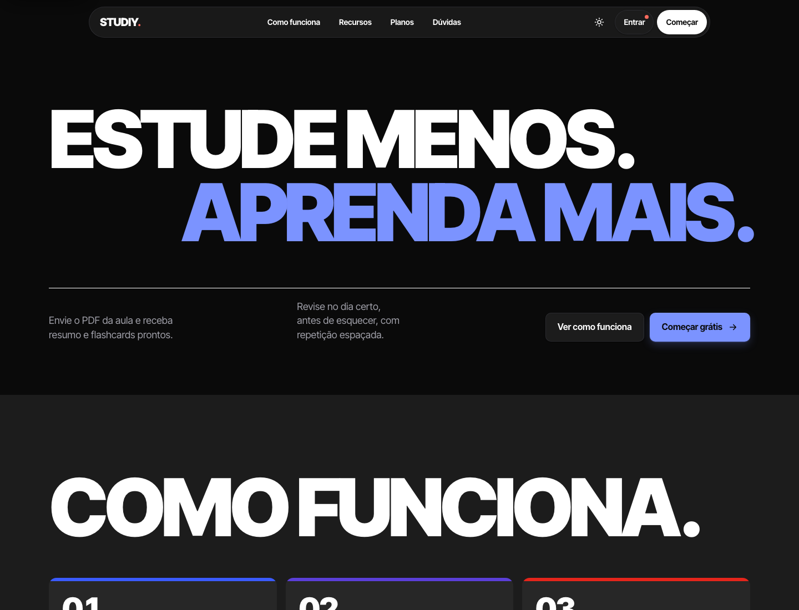

# Studiy

Plataforma de estudos: organize matérias, envie PDFs e receba resumo + flashcards com revisão espaçada (SM-2). Plano grátis (20 gerações/mês) e Pro (300/mês, R$ 20 por 30 dias, cartão ou Pix via Mercado Pago).

Licença MIT. Repositório público: todo o código é tratado como visível a atacantes. **Nenhuma regra de
negócio, cálculo, permissão ou segredo fica no front**; ele só exibe dados prontos da API.



**[Ver a galeria de design](docs/design/README.md)**: todas as telas (claro, escuro e celular) e os trechos de código mais relevantes do redesign.

```
frontend/            front estático (index, login, cadastro, dashboard, pagamento, admin, termos, privacidade...)
├── css/tokens.css   TODAS as cores (constantes). Edite aqui para mudar o visual.
├── fonts/           Plus Jakarta Sans hospedada localmente (licença OFL)
└── js/              config (gerado no build), api, auth, dashboard, pagamento, admin, onboarding, theme, ui
backend/             API Spring Boot 3 (Java 17) + PostgreSQL + Flyway
deploy/              build-front.sh (front por ambiente), Dockerfile do site, Caddyfile
.github/             CI, CodeQL, auditoria de dependências, dependabot
SECURITY.md · CONTRIBUTING.md · LICENSE · docker-compose.yml · .env.example
```

## Ver o projeto rodando (só Docker, sem IDE)

```bash
docker compose -f docker-compose.dev.yml up --build
```

- **Site + API:** http://localhost:8090 (mesma origem, igual à produção).
- **E-mails enviados** (confirmação de cadastro, aviso, redefinição de senha): http://localhost:8025 (Mailpit).
- Editou algo em `frontend/`? Recarregue a página: o serviço `front` reconstrói sozinho em ~2 s.
- Mudou o backend? Rode o mesmo comando de novo (o `--build` recompila a API).
- IA de verdade (opcional): `ANTHROPIC_API_KEY=... docker compose -f docker-compose.dev.yml up --build`;
  sem a chave, a IA devolve respostas de teste.
- Parar: `docker compose -f docker-compose.dev.yml down`. Apagar também o banco de dev: acrescente `-v`.

Usa o perfil `dev` (segredos públicos de desenvolvimento, nunca use para produção) e só abre portas
em `127.0.0.1`. Para admin: promova a conta com o comando da seção Administração, trocando o início por
`docker compose -f docker-compose.dev.yml exec db psql -U postgres -d studiy -c ...`.

## Rodar em desenvolvimento (com IDE)

O perfil **sem nome não sobe** (fail-closed): em dev use sempre `SPRING_PROFILES_ACTIVE=dev`.

```bash
docker run -d --name studiy-db -e POSTGRES_DB=studiy -e POSTGRES_PASSWORD=postgres -p 5432:5432 postgres:16
```

```bash
cd backend && SPRING_PROFILES_ACTIVE=dev mvn spring-boot:run
```

```bash
deploy/build-front.sh dev && python3 -m http.server 5500 --directory build/front-dev
```

Abra **http://localhost:5500** (use `localhost`, não `127.0.0.1`: os cookies de sessão são do host
`localhost`). Se a API não estiver na 8080: `API_ORIGIN=http://localhost:18080 deploy/build-front.sh dev`
e `SERVER_PORT=18080` no backend.

- No IntelliJ: abra `backend/` e adicione `SPRING_PROFILES_ACTIVE=dev` às variáveis de ambiente do Run.
- Em dev sem SMTP, os e-mails (link de confirmação, aviso de conta existente, redefinição de senha)
  aparecem no **log do backend**, e "Esqueci a senha" mostra o token na tela.
- Sem `ANTHROPIC_API_KEY`, a IA devolve respostas de teste (e o log de custo registra modelo `mock`).
- Swagger (só dev): http://localhost:8080/swagger-ui.html. Entre pelo front antes: o Swagger usa os
  mesmos cookies; escritas exigem o header `X-XSRF-TOKEN` igual ao cookie `XSRF-TOKEN`.

Problemas de conexão: `http://localhost:8080/api/saude` deve mostrar `{"status":"ok"}`.

## Testes

```bash
cd backend && mvn -B verify
```

- `mvn test`: só unitários (sem Docker).
- `mvn verify`: também os de integração (`*IT`), com **Postgres 16 real via Testcontainers** (Flyway
  aplica todas as migrations, MockMvc passa pela cadeia completa do Spring Security). Precisa de Docker.
- O que está coberto: guarda de inicialização, cadastro sem enumeração, verificação de e-mail,
  bloqueio de login e tempo mínimo, sessão em cookies (flags, CSRF, rotação/reuso do refresh, CORS),
  rate limit por usuário (e em Redis), regras no servidor, log de IA e retenção, admin com MFA e
  **isolamento entre contas em todas as rotas com ID** (matéria, PDF, resumo, flashcard, atividade,
  pedido, incluindo IDs cruzados), sempre esperando 404.
- O CI (`.github/workflows/ci.yml`) roda tudo isso, além do build de produção do front, da proibição de
  `innerHTML` e do gitleaks.

### Teste manual rápido do fluxo de sessão

1. Cadastre-se: a resposta é sempre a mesma mensagem, para e-mail novo ou repetido.
2. Copie o link `verificar-email.html#token=...` do log do backend e abra-o.
3. Entre. Em DevTools → Application → Cookies, `studiy_at` e `studiy_rt` devem estar como **HttpOnly**
   e `SameSite=Strict`; `document.cookie` no console mostra só `XSRF-TOKEN`.
4. Erre a senha 5 vezes: a conta bloqueia por 1 min (dobrando até 60 min), com a mesma mensagem de erro.

## Pagamento (Mercado Pago)

- Criar a conta e o app em mercadopago.com.br/developers é gratuito, e o webhook também. A cobrança é só a taxa por venda aprovada.
- Dev: `studiy.pagamento.simulacao=true` faz o checkout virar um teste local, sem cobrança.
- Testar com Mercado Pago de verdade: `MP_ACCESS_TOKEN` de TESTE, túnel (ngrok) em `API_PUBLIC_URL`, e cadastre `{API_PUBLIC_URL}/api/pagamentos/webhook` no painel (evento "Pagamentos"); copie a assinatura secreta para `MP_WEBHOOK_SECRET`.
- O Pro só é liberado depois de webhook com `x-signature` válida e consulta direta à API do Mercado Pago; preço e duração são decididos no servidor.

## E-mail (confirmação de cadastro, aviso de conta existente, recuperação de senha)

Qualquer SMTP serve: Brevo, Resend, Mailgun ou Gmail com senha de app. Preencha
`SPRING_MAIL_HOST/PORT/USERNAME/PASSWORD`, `MAIL_FROM` e `FRONT_URL` no `.env`. A confirmação de e-mail
é **obrigatória**: sem ela a conta entra, mas não gera com IA nem assina o Pro. Contas criadas antes
da V7 já contam como confirmadas. **Sem SMTP em produção, ninguém consegue confirmar o e-mail.**

## Deploy (Docker + HTTPS)

```bash
cp .env.example .env
```

```bash
docker compose up -d --build
```

- `db` (Postgres), `api` (Spring Boot, só na rede interna) e `web` (Caddy com o front **já buildado
  para produção** dentro da imagem, encaminha `/api` para a API e emite o HTTPS sozinho).
- Front e API na mesma origem: `API_ORIGIN` vazio. Se a API ficar em outro domínio, defina
  `API_ORIGIN=https://api.seudominio` (o build recusa `http://` e `localhost`).
- `CORS_ORIGINS` = origens exatas do front (sem `*`). `FRONT_URL` = URL pública do front.
- O perfil padrão do compose é `prod`. A **StartupGuard** aborta a subida se faltar variável, se o
  JWT secret tiver menos de 32 bytes, se o secret ou a chave forem os valores públicos de dev, se
  simulação de pagamento, exposição de token, cookie sem `Secure` ou CORS com `*` aparecerem fora de dev.
- Várias instâncias da API: defina `STUDIY_REDIS_URL` (rate limit compartilhado). Proxy fora da rede
  Docker padrão: ajuste `TRUSTED_PROXIES` (regex dos IPs confiáveis para `X-Forwarded-For`).
- Backup do volume `pgdata`. Guarde a `STUDIY_ENCRYPTION_KEY` fora do servidor: perdê-la significa
  perder os dados cifrados.

## Segredos: gerar e rotacionar

Os valores em `application-dev.properties` são **públicos** e só funcionam no perfil dev. Para
qualquer outro ambiente, gere valores novos (e guarde-os num cofre, nunca no Git):

```bash
openssl rand -base64 48
```

```bash
openssl rand -base64 32
```

O primeiro é o `JWT_SECRET`; o segundo, a `STUDIY_ENCRYPTION_KEY` (exatamente 32 bytes).

| Segredo | Como rotacionar | Efeito |
|---|---|---|
| `JWT_SECRET` | Troque a variável e reinicie a API. | Tokens de acesso (15 min) param de valer na hora; o refresh token (opaco, no banco) emite um novo sozinho. Para derrubar **todas** as sessões: `DELETE FROM sessoes_refresh;`. |
| `STUDIY_ENCRYPTION_KEY` | **Ainda não há rotação automática** (veja "Ainda não feito"). Trocar a chave sem recifrar torna ilegíveis PDFs, resumos, flashcards, avatar e segredo MFA. | Se houver suspeita de vazamento: exporte/recifre com script dedicado antes de trocar. |
| `MP_ACCESS_TOKEN` / `MP_WEBHOOK_SECRET` | Gere novos no painel do Mercado Pago e atualize o `.env`. | Webhooks com assinatura antiga passam a ser recusados. |
| `ANTHROPIC_API_KEY` | Crie uma nova no Console da Anthropic, atualize e revogue a antiga. | Nenhum. |
| `DB_PASSWORD` | `ALTER USER ... PASSWORD ...` no Postgres e atualize o `.env`. | Reinicie a API. |

## Administração

Nenhuma rota da API altera o papel de alguém: para promover um admin, rode direto no banco:

```bash
docker compose exec db psql -U "$DB_USER" -d studiy -c "UPDATE usuarios SET papel='ADMIN' WHERE email='voce@exemplo.com';"
```

No primeiro acesso a `admin.html`, configure o segundo fator (TOTP) num app autenticador e confirme
com o código. Depois disso, cada login exige o código antes de abrir o painel: só a sessão verificada
recebe `ROLE_ADMIN`. **Configure o MFA logo depois de promover** (antes disso, a senha sozinha
permite fazer a configuração inicial). Para resetar o MFA de alguém (perdeu o celular):
`UPDATE usuarios SET mfa_ativo=false, mfa_segredo=null, mfa_ultimo_passo=null WHERE email='...';`

O painel mostra usuários, pedidos e uso de IA (chamadas, tokens e custo estimado por dia, além dos
maiores consumidores). Os preços por milhão de tokens ficam em `studiy.ia.preco.*`.

## Repositório: proteção recomendada no GitHub

Em **Settings → Branches → Add rule** para `main`:

- Exigir pull request com pelo menos 1 aprovação e descartar aprovações em novos commits.
- Exigir os status checks: `Backend`, `Front`, `Segredos no histórico (gitleaks)` e `CodeQL`.
- Exigir branch atualizada antes do merge e resolução de conversas.
- Bloquear force push e exclusão da branch; incluir administradores.
- Em **Settings → Code security**: ligar Private vulnerability reporting, Dependabot alerts e
  security updates, Secret scanning e Push protection.
- (Opcional) Fixar as actions por SHA em vez de tag; o dependabot de `github-actions` mantém atualizado.

## Cores (tokens)

Paleta: roxo, rosa e azul pastéis, em `frontend/css/tokens.css` (primitivas `--c-*`, semânticas claro/escuro e paleta da matéria). Cada cor tem um papel só:

- Roxo: ação principal (botões, links, foco, barras) e seções de destaque. Lilás: fundos suaves (hero, chamada final).
- Rosa: só detalhes pequenos (selo, destaque pontual). Azul pastel: só avisos e dicas. Vermelho: só excluir e erros.
- Botões: `.btn-grad` primário, `.btn-ghost` secundário, `.btn-light` primário sobre fundo escuro, `.btn-dark` menu, `.btn-danger` excluir.
- Cores de matéria: as chaves `azul|roxo|vermelho|grafite` ficam no banco, então não mudam; "vermelho" agora exibe o Rosa. Para criar uma nova, adicione um bloco `[data-subject="x"]`, um `.swatch[data-k="x"]`, a chave em `js/config.js` e no `@Pattern` de `MateriaRequest`.

## Segurança implementada

**Configuração e segredos**
- Fail-closed: o perfil sem nome exige todas as variáveis; os padrões ficam só em `application-dev.properties`.
- StartupGuard (veja Deploy); `/api/pagamentos/{id}/simular` e Swagger só existem com `@Profile("dev")`.
- gitleaks no histórico inteiro e no CI (resultado em 2026-11-05: **nenhum segredo real**; um falso
  positivo, o nome do modelo, está no `.gitleaksignore`).

**Autenticação e sessão**
- Cadastro sem enumeração: mesma resposta (202) e mesmo custo (bcrypt) para e-mail novo ou existente;
  quem já tem conta recebe um e-mail de aviso.
- Verificação de e-mail obrigatória: token de 256 bits, só o hash no banco, uso único, 24 h. IA e
  pagamento ficam bloqueados até confirmar; trocar o e-mail exige nova confirmação.
- Login com tempo constante (sempre um bcrypt, hash fictício para e-mail inexistente, tempo mínimo de
  400 ms) e mesma resposta para senha errada, e-mail inexistente ou conta bloqueada.
- Bloqueio progressivo por conta (5 falhas → 1 min, dobrando até 60 min), além do rate limit por IP.
- Sessão em cookies **HttpOnly + Secure + SameSite=Strict**: acesso JWT de 15 min (`Path=/api`) e
  refresh opaco rotativo de 14 dias (`Path=/api/auth`, só o hash no banco). Reusar um refresh já
  trocado derruba a família inteira. O header `Authorization` não é aceito.
- CSRF double-submit (`XSRF-TOKEN` + `X-XSRF-TOKEN`) em toda escrita, exceto o webhook assinado.
- CORS com origens exatas e `allowCredentials`. Logout, troca de senha ou e-mail e exclusão revogam
  todas as sessões.
- ADMIN com MFA TOTP (RFC 6238, segredo cifrado, código não reutilizável, falhas no mesmo bloqueio);
  `/api/admin/**` por regra de URL e `@PreAuthorize`.

**Abuso e custo**
- Rate limit Bucket4j dentro da cadeia do Spring Security, depois da autenticação (por usuário de
  verdade), em memória ou Redis. `X-Forwarded-For` só é aceito do proxy confiável.
- Cota mensal por plano; log de tokens e custo de cada chamada de IA (sem conteúdo); recusa do modelo
  vira erro claro.

**Dados**
- Isolamento por usuário em todas as rotas com ID (404, testado com 2 contas).
- AES-256-GCM em PDFs, resumos, flashcards, avatar e segredo MFA; bcrypt 12.
- Validação de PDF (assinatura, 10 MB, 300 páginas) e de avatar (tipo real, 150 KB) no servidor.
- Retenção diária: apaga refresh tokens vencidos, tokens de senha e verificação expirados e log de IA
  com mais de 180 dias.
- LGPD: exportar dados, excluir conta e aceite de termos versionado (o aceite agora é validado no
  servidor; antes o front mandava `true` fixo).

**Front**
- Nenhuma regra no front: plano, limites, percentuais, XP/nível, escala SM-2, preço formatado, URL de
  retorno do checkout e onboarding vêm da API.
- CSP por ambiente gerada no build (prod: `connect-src 'self'` ou a API em HTTPS, sem `localhost`),
  também enviada como header pelo Caddy (com `frame-ancestors 'none'`).
- Fonte hospedada localmente (sem Google Fonts); `font-src 'self'`.
- Dados da API sempre via `textContent`/`createElement`; o CI bloqueia `innerHTML`.

**Cadeia de suprimentos**
- Dependabot (maven, actions, docker), CodeQL (Java e JS), OWASP Dependency-Check (CVSS ≥ 7 falha) e
  gitleaks no CI.

## Ainda NÃO feito

- **Rotação da `STUDIY_ENCRYPTION_KEY`** com recifragem: suporte a chave antiga e nova (prefixo `enc:v2:`)
  e um job que recifre os dados.
- Desabilitar ou resetar o MFA pela API (hoje é só pelo banco) e códigos de recuperação do MFA.
- Teste do pagamento com credenciais reais do Mercado Pago.
- Preencher os `[PLACEHOLDERS]` de `privacidade.html` e `termos.html` e revisar com um profissional jurídico.
- Contratar o SMTP (sem ele, ninguém confirma o e-mail em produção).
- Exibir um QR code na configuração do MFA (hoje mostra a chave e o link `otpauth://`).
- Revisão de design do front (próxima etapa).
- Fixar as GitHub Actions por SHA e configurar a branch protection (veja acima).
