# Design do Studiy — editorial suíço com movimento

Capturas do redesign do frontend. As telas do painel, flashcard, perfil e pagamento usam **dados de exemplo** (API simulada só para a captura); nada aqui vem de contas reais. Capturadas com "reduzir movimento" ligado, por isso os títulos aparecem já resolvidos (sem o efeito de embaralhar).

## Telas

| | |
|---|---|
|  | 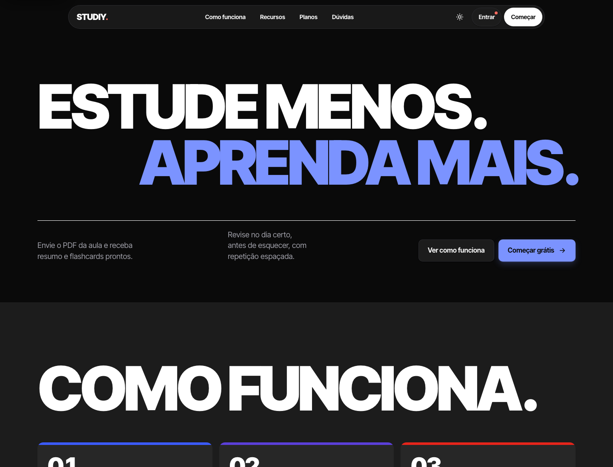 |
| Landing (claro) | Landing (escuro) |
| 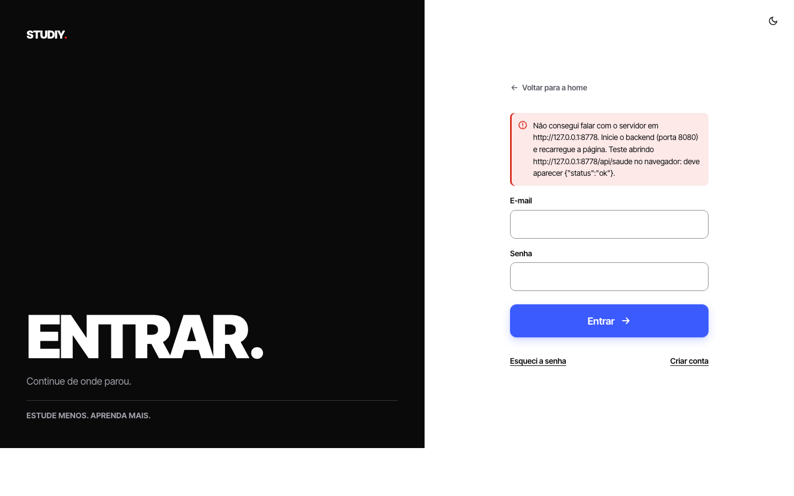 | 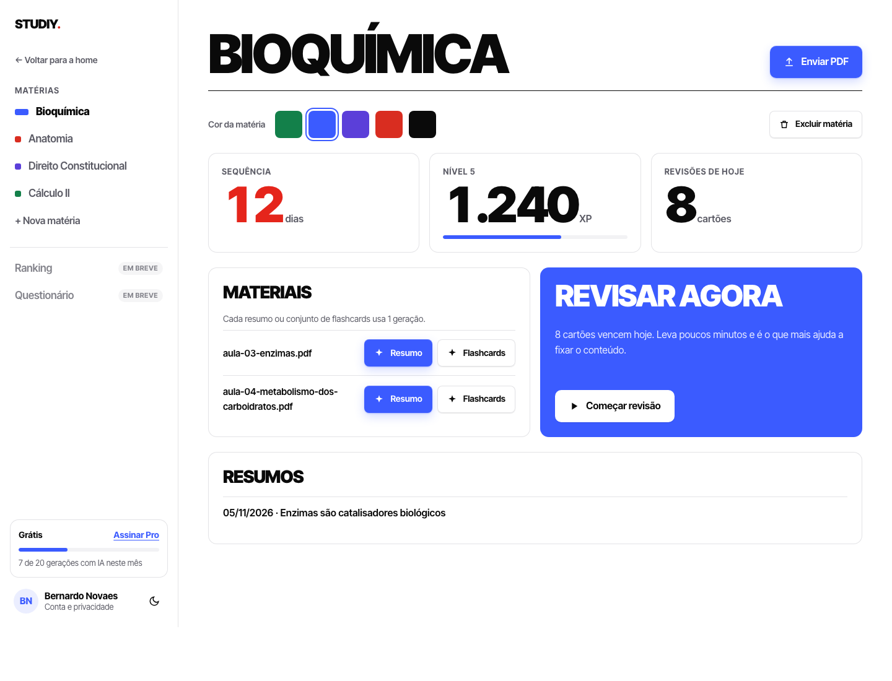 |
| Login (split) | Painel (claro) |
| 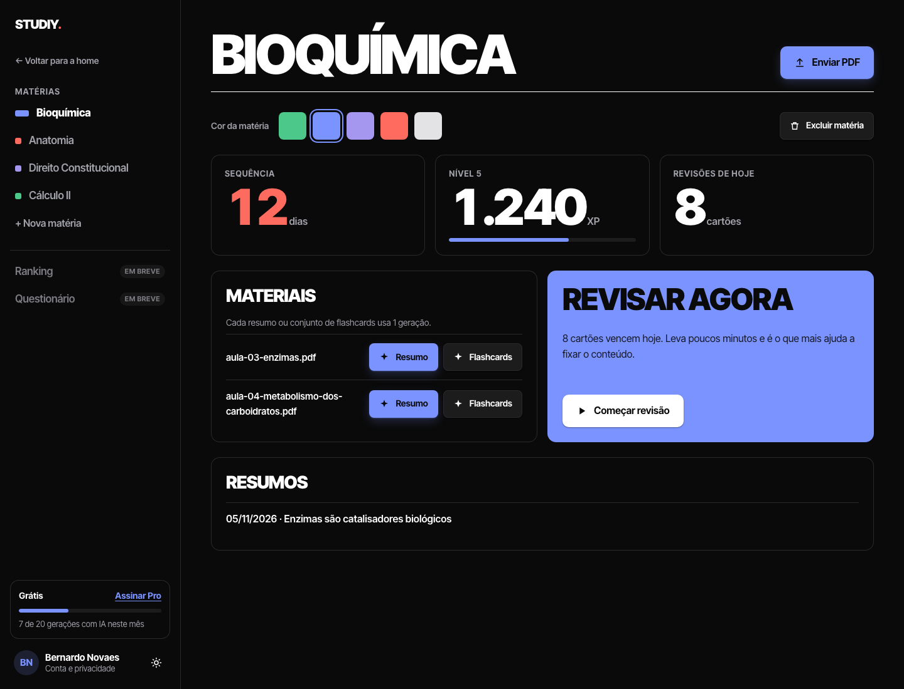 | 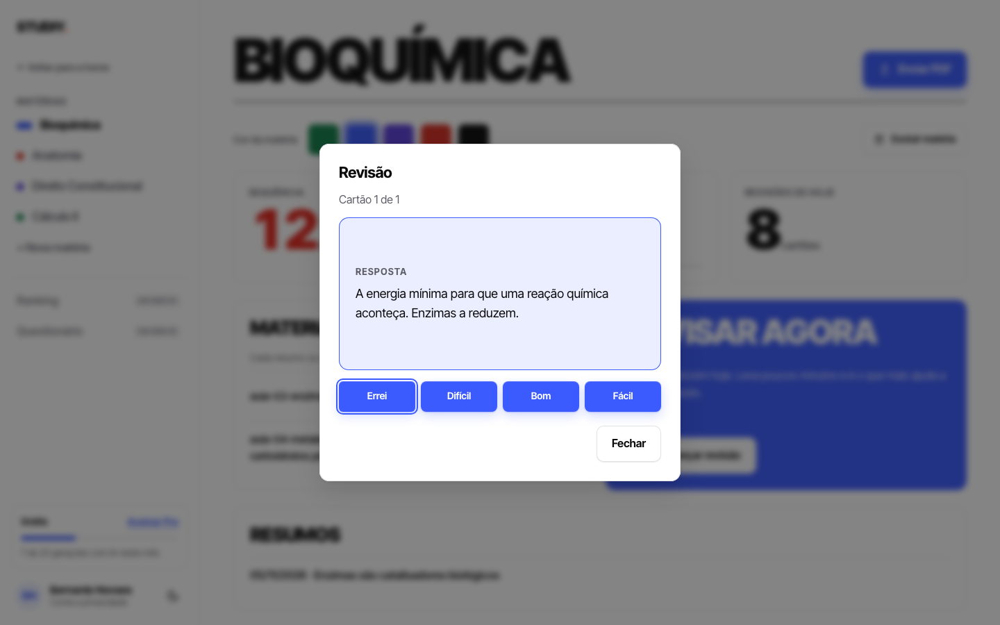 |
| Painel (escuro) | Revisão com flashcard virado |
| 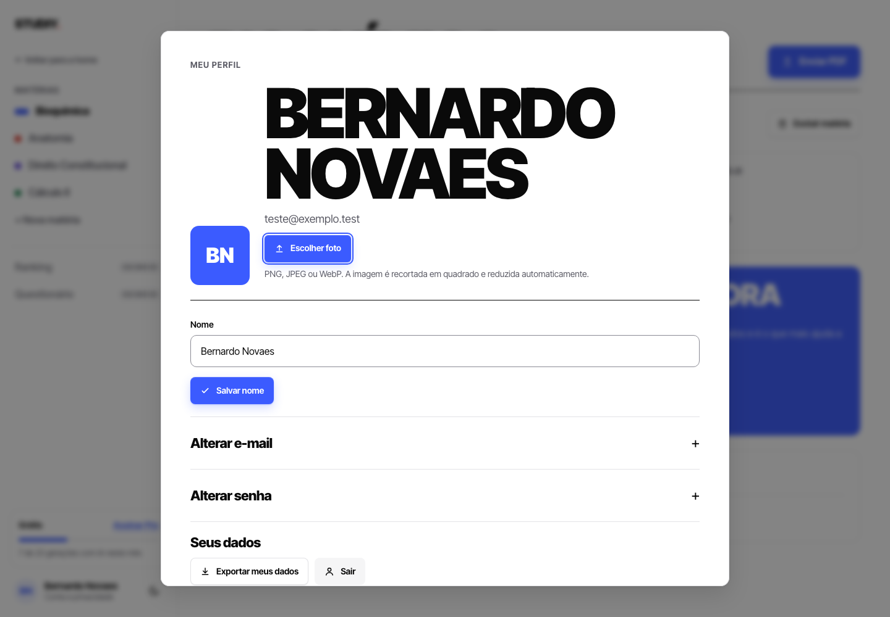 |  |
| Perfil (nome gigante) | Assinatura do Pro |
| 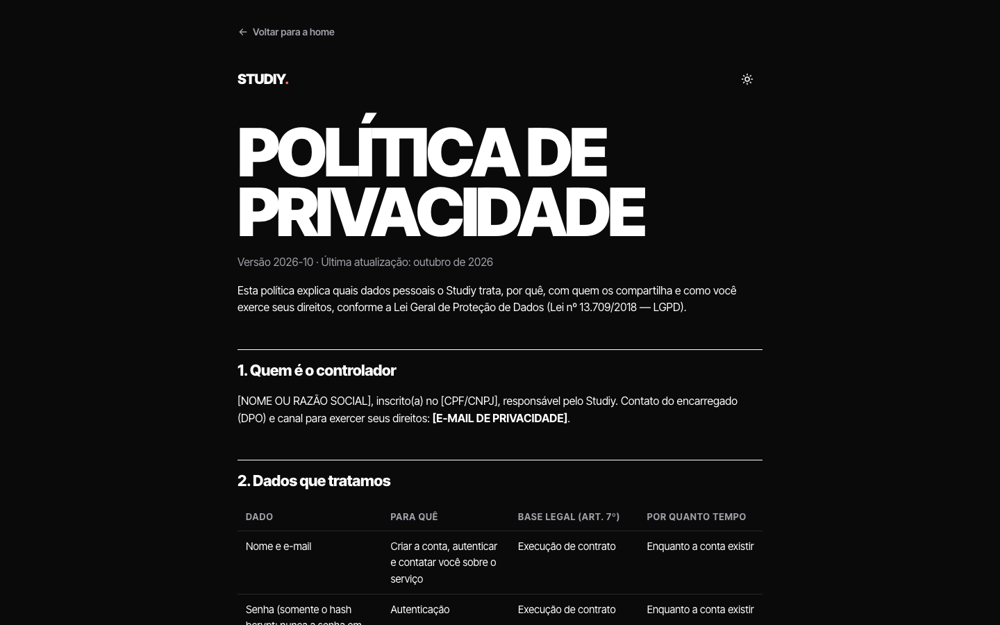 | |
| Páginas legais (escuro) | |

Celular (390 px):

| | | |
|---|---|---|
|  | 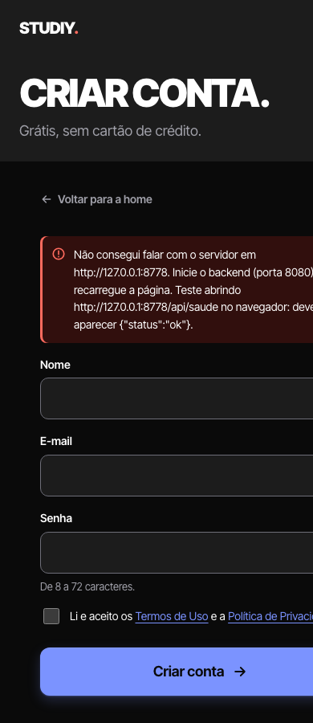 | 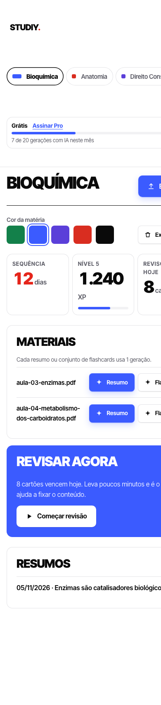 |
| Landing | Cadastro (escuro) | Painel |

## Código mais relevante

1. **Tokens semânticos** — uma cor = um papel; o tema escuro só redefine os papéis. [`frontend/css/tokens.css`](../../frontend/css/tokens.css)
   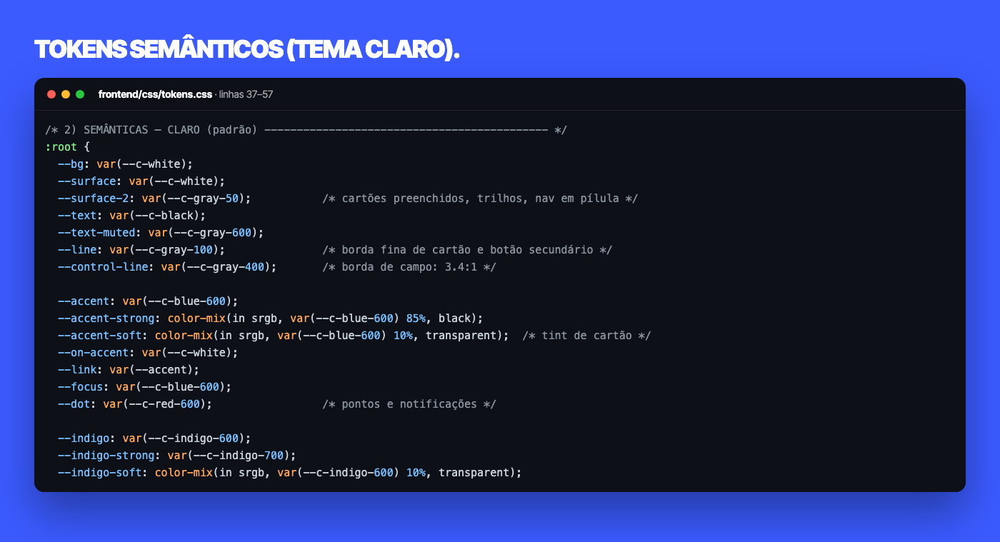
2. **Variantes de botão e estado carregando** — cada variante define 5 variáveis privadas; hover, foco e spinner ficam no `.btn` base. [`frontend/css/buttons.css`](../../frontend/css/buttons.css)
   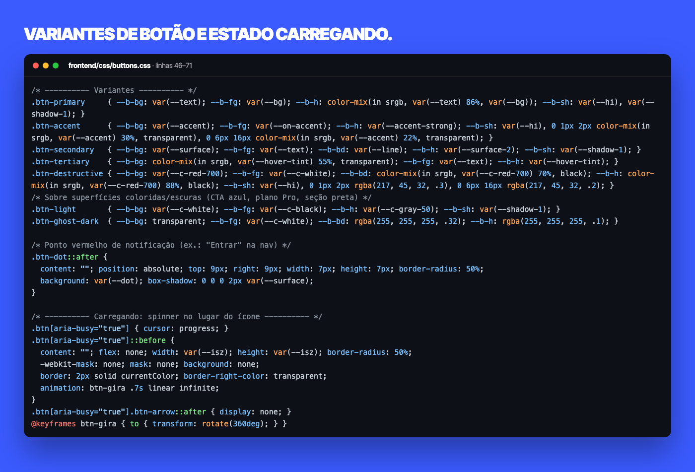
3. **`data-scramble`** — percorre os nós de texto (preserva ` `/``, nunca usa `innerHTML`) e expõe o texto final a leitores de tela. [`frontend/js/motion.js`](../../frontend/js/motion.js)
   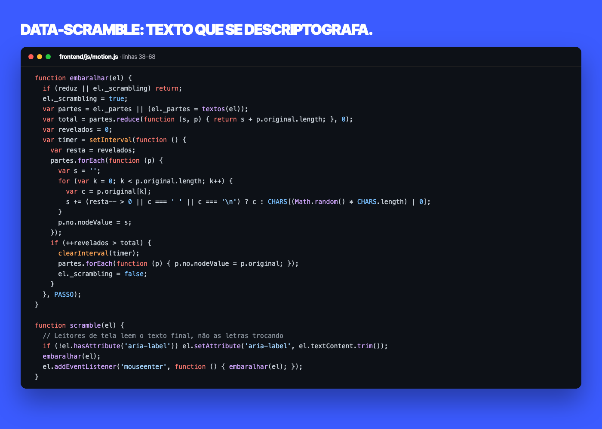
4. **Flashcard com flip 3D** — frente e verso trocam `aria-hidden` e o foco vai para a primeira nota. [`frontend/js/dashboard.js`](../../frontend/js/dashboard.js)
   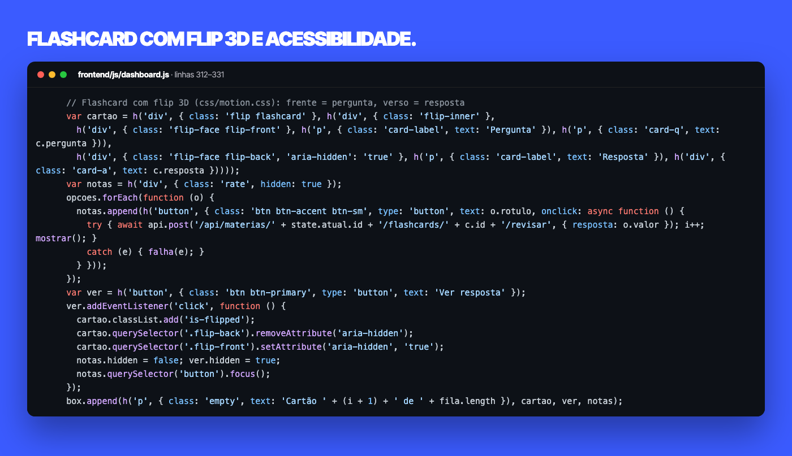
5. **Flip 3D em CSS** — faces empilhadas em grid (a altura acompanha o lado maior) e troca por opacidade com movimento reduzido. [`frontend/css/motion.css`](../../frontend/css/motion.css)
   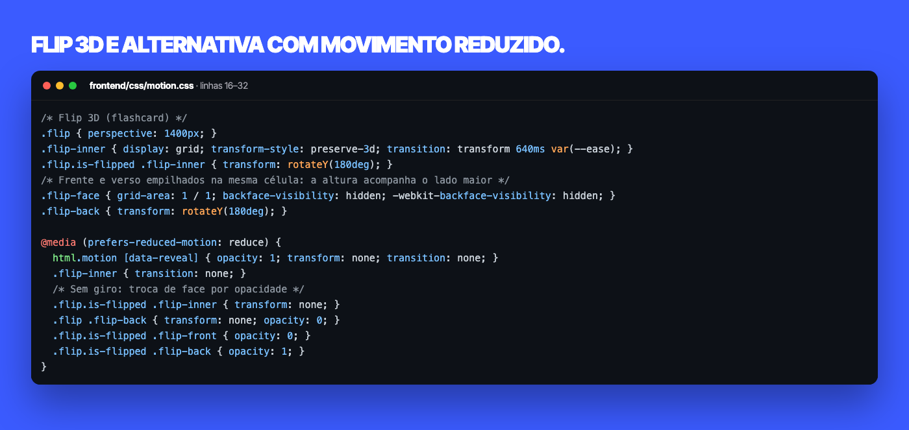

As imagens de código mostram trechos exatos dos arquivos, com o caminho e as linhas no topo de cada janela.
